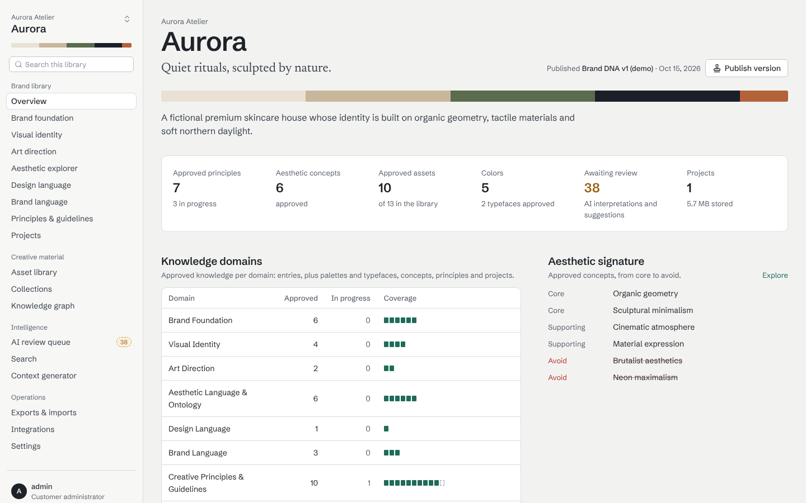
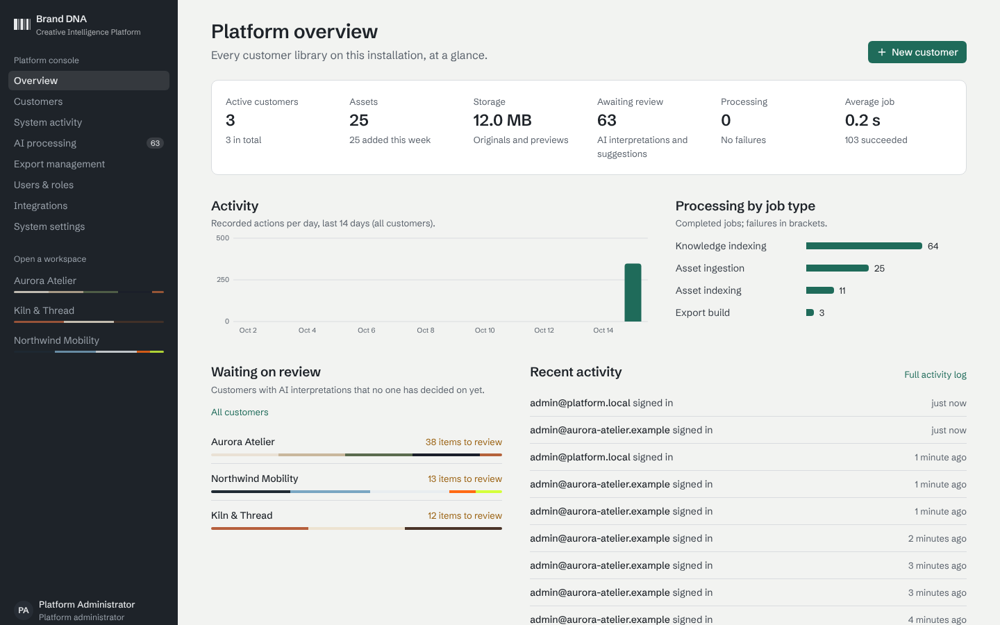
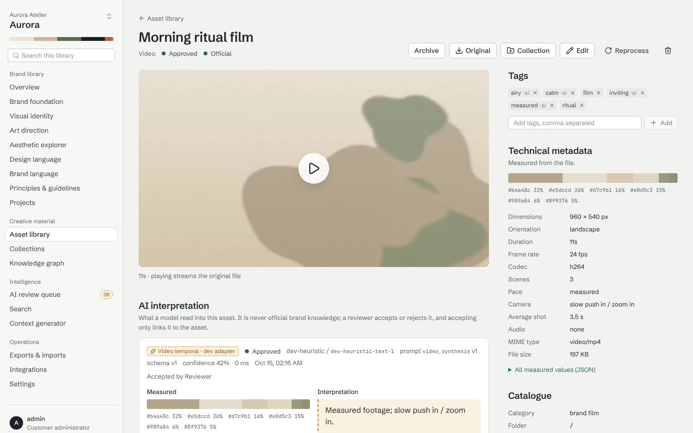
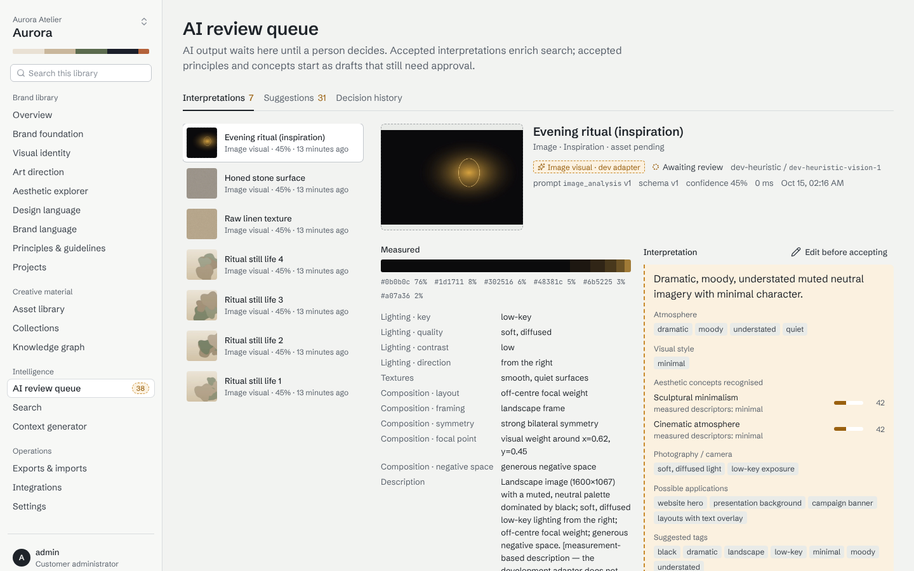
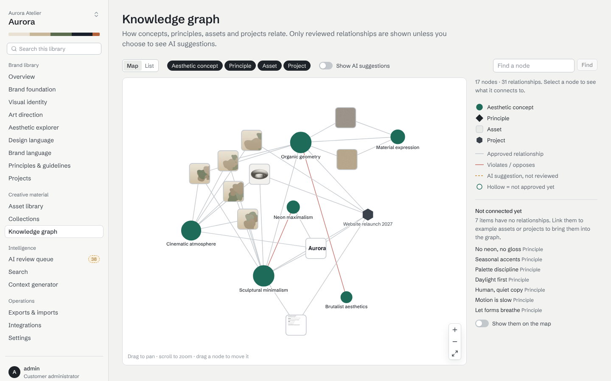

# Brand DNA & Creative Intelligence Platform

A multi-tenant platform where an agency keeps the **brand DNA** of each customer — foundation,
visual identity, art direction, aesthetic vocabulary, design and brand language, principles and
creative material — as governed, searchable knowledge, and turns it into task-specific briefs
for designers, developers and AI models.



## What it does

* **Agency console** — onboard customers (workspace, first brand, administrator), manage users
  and roles, watch processing across customers, export registry, integrations inventory, system
  settings, archive and scheduled deletion.
* **Customer workspaces**, isolated by PostgreSQL Row Level Security, with one or more brands and
  the ten knowledge domains: foundation · visual identity · art direction · aesthetic language ·
  design language · brand language · creative assets · principles & guidelines · projects ·
  AI knowledge.
* **Asset ingestion** for images, video, documents, 3D and audio: originals preserved
  byte-for-byte, derivatives, objective measurements (palette, light, composition; video scenes
  and camera movement; document pages), AI interpretation kept separate from fact.
* **Human approval** — AI output and drafts are never official until a person approves them;
  immutable revisions; published brand versions.
* **Aesthetic ontology and knowledge graph** — concepts with relevance, synonyms, related and
  opposing concepts, example assets; typed relationships between everything.
* **Hybrid search** — keywords, meaning, the graph, measured media properties and visual
  similarity in one ranked list ("videos with slow cinematic camera movements").
* **Creative context generator** — task templates (website, campaign, social, image/video
  generation …) → a sourced, checksummed brief in Markdown/JSON/YAML/ZIP.
* **Exports and imports** — full or selective, self-describing, every file checksummed; staged,
  validated, atomic imports.
* **REST API, webhooks (n8n), read-only MCP server** for AI assistants — all scoped to one
  workspace per credential.

| | |
|---|---|
|  |  |
|  |  |

Screenshots show the fictional demo customer "Aurora Atelier".

## Quick start (Docker Compose)

```bash
cp .env.example .env                      # replace every CHANGE-ME
docker compose up -d --build
docker compose run --rm api python -m app.cli create-admin --email you@agency.example
open http://localhost:8080
```

Optional: `docker compose --profile demo run --rm demo-seed` loads three **fictional** demo
customers (development and evaluation only). Production setup — HTTPS, R2/S3, managed Postgres
such as Supabase, backups — is in [docs/operations.md](docs/operations.md).

### Demo logins (after loading the demo data)

| Who | E-mail | Password |
|---|---|---|
| Platform administrator | `admin@platform.local` | set by `BDNA_DEMO_ADMIN_PASSWORD` (`admin-password-2026` in `scripts/reset-dev.sh`) |
| Customer roles | `{admin, creative.director, editor, reviewer, viewer}@{aurora-atelier, northwind-mobility, kiln-and-thread}.example` | `demo-password-2026` |

## Development

```bash
# backend (Python 3.12+, PostgreSQL 16+ with pgvector, ffmpeg, tesseract)
cd backend && python -m venv .venv && .venv/bin/pip install -e '.[dev]' && cp .env.example .env
.venv/bin/python -m app.cli migrate && .venv/bin/uvicorn app.main:app --reload
.venv/bin/python -m app.cli worker
# frontend (Node 22)
cd frontend && npm ci && npm run dev       # http://localhost:3000
scripts/reset-dev.sh                       # wipe local data and load the demo customers
```

Full native setup (database roles, test database): [docs/operations.md](docs/operations.md#native-development).

### Tests

```bash
cd backend && .venv/bin/python -m pytest          # API, RLS isolation, pipeline, search, context, exports, MCP
cd backend && .venv/bin/ruff check app tests
cd frontend && npm run typecheck && npm run lint
cd frontend && npx playwright test                # end-to-end against a running dev stack with demo data
```

## Repository

| Path | |
|---|---|
| `backend/` | FastAPI API, worker, MCP server, CLI, Alembic migrations, tests |
| `frontend/` | Next.js dashboard, Playwright tests |
| `deploy/` | Postgres role bootstrap, Caddy configuration |
| `docker-compose.yml`, `.env.example` | deployment |
| `scripts/` | backup, restore, development reset |
| `n8n/` | example automation workflow |
| `docs/` | documentation (below) |

## Documentation

| Document | |
|---|---|
| [Architecture](docs/architecture.md) | system, data model, pipelines, dashboard |
| [Security](docs/security.md) | isolation, authentication, permissions matrix, data protection |
| [REST API](docs/api.md) | conventions and endpoint map (interactive reference at `/docs`) |
| [MCP server](docs/mcp.md) | tools, connection, access model |
| [Export format](docs/export-format.md) | archive layout, manifest, verification, import |
| [Operations](docs/operations.md) | deploy, configure, upgrade, back up, retention, monitoring |
| [Decisions (ADRs)](docs/adr/README.md) | why it is built this way |
| [Progress log](docs/progress-log.md) | what was built, and how it was verified |
| [Unfinished features](docs/unfinished-features.md) | known gaps and unverified parts |

## Status

Functional end to end with the **development AI adapter** (deterministic, measurement-based and
labelled everywhere it appears). Real providers (Anthropic, OpenAI-compatible, a self-hosted
visual-embedding service) are configuration. See
[unfinished features](docs/unfinished-features.md) before a production launch — notably
SSO/MFA, outgoing e-mail, and that Docker images and live AI providers were not exercised in the
build environment.
