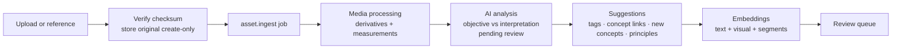

# Architecture

The Brand DNA & Creative Intelligence Platform turns a customer's brand — its foundation,
visual identity, art direction, aesthetic vocabulary, language, principles and creative
material — into governed, searchable knowledge that people, automations and AI assistants can
use. An agency runs one installation for many customers; each customer's library is isolated
in the database itself.

Decisions and their trade-offs are recorded in [ADRs](adr/README.md).

## System

```mermaid
flowchart LR
  subgraph Clients
    B[Browser<br/>dashboard]
    S[Scripts / n8n<br/>API tokens]
    A[AI assistants<br/>MCP clients]
  end
  C[Caddy<br/>one origin, TLS]
  W[Next.js dashboard]
  API[FastAPI<br/>REST /v1]
  M[MCP server<br/>read-only]
  Q[(PostgreSQL + pgvector<br/>RLS · jobs · vectors)]
  O[(Object storage<br/>S3 · R2 · MinIO · local)]
  K[Worker(s)<br/>media · AI · embeddings · exports · webhooks]
  P[AI providers<br/>Anthropic · OpenAI-compatible · dev adapter]
  N[n8n]

  B --> C
  S --> C
  A --> C
  C -- "/v1/*" --> API
  C -- "/mcp" --> M
  C -- "everything else" --> W
  API --> Q
  M --> Q
  K --> Q
  API --> O
  K --> O
  K --> P
  API --> P
  K -- signed webhooks --> N
  N -- API token --> C
```

| Process | Command | Role |
|---|---|---|
| API | `uvicorn app.main:app` | REST API, auth, uploads, signed file URLs (local storage) |
| Worker | `python -m app.cli worker` | Claims jobs: ingestion, embeddings, exports, imports, re-index, webhooks, purges, janitor |
| MCP | `python -m app.mcp --transport streamable-http` | Read-only tools for AI clients, one workspace per token |
| Dashboard | `node server.js` (Next standalone) | Admin console and customer workspaces |
| Migrate | `python -m app.cli migrate && python -m app.cli check` | Schema migrations + isolation self-check |

## Tenancy and security model

* **Organization** = a customer workspace. A workspace has one or more **brands**; almost
  everything belongs to a brand. **Platform administrators** (agency staff) manage customers
  from `/admin`; customer members work in `/w/<org>/<brand>`.
* Six roles: platform super administrator, customer administrator, creative director, editor,
  reviewer, viewer. Permissions are data (`roles`, `role_permissions`), checked per endpoint;
  the matrix is shown in the admin console (Users → Roles).
* Isolation is enforced by PostgreSQL Row Level Security with three database roles — see
  [ADR 0002](adr/0002-tenant-isolation.md). Every request runs as `bdna_app` inside a
  transaction with `app.org_id` set; without it, tenant tables return nothing.
* Details of authentication, CSRF, tokens, throttling and secrets: [security.md](security.md).

### Request lifecycle

1. Caddy forwards `/v1/*` to the API (uploads stream through).
2. `app/api/deps.py` authenticates: session cookie (+ `X-BDNA-CSRF` on writes) or `Bearer bdna_…`.
3. The workspace is resolved from `X-Organization-Id` (session users must be members; tokens are
   bound to one workspace, optionally one brand). Archived workspaces and workspaces pending
   deletion are closed to their members (platform administrators can still open them).
4. A tenant session opens on the `bdna_app` role with `SET LOCAL app.org_id, app.user_id`.
5. The endpoint checks its permission, does its work, writes audit entries and enqueues jobs in
   the same transaction, then commits.

## Data model

| Area | Main tables |
|---|---|
| Identity | `users`, `organizations`, `organization_users`, `roles`, `role_permissions`, `auth_sessions`, `api_tokens`, `audit_logs` |
| Brand | `brands`, `brand_versions` (published snapshots), `knowledge_domains` (reference) |
| Governed knowledge | `knowledge_entries`, `principles`, `guidelines`, `aesthetic_concepts`, `knowledge_revisions` |
| Visual identity | `palettes`, `color_tokens`, `typography_systems`, `design_tokens` |
| Assets | `assets`, `asset_derivatives`, `asset_segments` (scenes, pages), `asset_tags`, `external_references`, `collections`, `collection_assets` |
| AI | `asset_analyses`, `ai_suggestions`, `reviews`, `embeddings`, `prompt_templates` |
| Graph | `relationships` (typed edges between any two entities of a brand) |
| Work | `projects`, `context_packages`, `processing_jobs`, `export_jobs`, `import_jobs`, `integrations` |

All tenant tables carry `organization_id`; child rows use composite foreign keys
`(organization_id, parent_id)` so they cannot reference another tenant's parent.

### The ten knowledge domains

| # | Domain | Stored as |
|---|---|---|
| 1 | Brand foundation | knowledge entries (mission, vision, positioning, personality, values, audience …) |
| 2 | Visual identity | palettes + colors (HEX/RGB/HSL/OKLCH/CMYK, WCAG contrast), typography, logo assets, entries, design tokens |
| 3 | Art direction | entries with *objective observations* kept apart from *aesthetic interpretation* |
| 4 | Aesthetic language & ontology | aesthetic concepts with definition, synonyms, relevance (core … avoid), related/opposing concepts, example assets |
| 5 | Design language | entries + design tokens (CSS variables, DTCG JSON, Tailwind export) |
| 6 | Brand language | entries: tone of voice, vocabulary, restricted expressions, examples |
| 7 | Creative asset repository | assets, derivatives, segments, collections |
| 8 | Principles & guidelines | principles classified mandatory / preferred / optional / prohibited / context-dependent / experimental; guidelines |
| 9 | Projects & applications | projects with brief, selected domains, linked concepts/principles/assets, context packages |
| 10 | AI knowledge & operations | analyses, suggestions, review history, prompts, embeddings, context packages |

Entry types and their structured fields are defined once in `app/knowledge/registry.py` and
served to the dashboard (`GET /v1/knowledge/registry`), so forms, views and exports agree.

### Governance

Lifecycle `draft → in_review → approved | rejected → deprecated | archived`; approval by a
signed-in person only; immutable revisions; "official view" = last approved revision; brand
versions are published snapshots. See [ADR 0003](adr/0003-governed-knowledge.md).

## Asset ingestion



| Family | Processing |
|---|---|
| Images (JPEG, PNG, WebP, TIFF, GIF), SVG — HEIC is recognised but needs `pillow-heif` to decode | thumbnails/previews, dominant palette, luminance, contrast, saturation, edge density, symmetry, focal point |
| Video | ffprobe metadata; scene detection (PySceneDetect Adaptive ∪ Histogram); keyframes per scene; camera movement per scene from optical flow (pan/tilt/zoom/roll/static/handheld, speed, steadiness); preview proxy |
| Documents (PDF, DOCX, PPTX, Markdown, text) | PyMuPDF text and page renders, Tesseract OCR for scanned pages, DOCX/PPTX text and properties, Docling when installed; pages and chunks become segments |
| 3D (glTF/GLB, OBJ, STL, PLY …) | trimesh statistics (bounds, faces, watertightness …) and a flat-shaded preview render |
| Audio | technical metadata (ffprobe) |

Measurements are objective and stored on the asset (`media_metadata`); the AI analysis
receives them and must keep its *interpretation* separate. Nothing in the pipeline creates
approved knowledge.

## AI layer

`app/ai` — protocols for vision, text, embeddings and OCR; Anthropic, OpenAI-compatible and
HTTP visual-embedding implementations; the deterministic **development adapter**; versioned
prompts with per-workspace overrides; Pydantic schemas validating every model response. Resolution:
workspace override → environment → development adapter. See [ADR 0004](adr/0004-provider-independent-ai.md).

## Search and the knowledge graph

Hybrid search over keyword, semantic, relationship, metadata and visual signals fused with
weighted reciprocal rank; approval-aware; matched video scenes and document pages are reported.
See [ADR 0006](adr/0006-hybrid-search.md). The graph (`relationships`) holds typed edges
(exemplifies, violates, related to, opposes, broader than, applies to, uses, derived from,
supports, references, part of); AI-proposed edges stay `suggested` until reviewed.

## Creative context generator

`app/context` builds a task-specific brief from approved knowledge:

1. A **task template** (website design, website development, social media, brand campaign,
   graphic design, product design, image generation, video generation, presentation,
   copywriting, other) selects domains, instructions and a deliverable checklist.
2. The request adds a project, concepts to emphasise, reference assets or collections, creative
   direction and a depth (compact / standard / comprehensive).
3. Selection takes approved items only (or a published brand version), principles grouped by
   classification, prohibited directions (including concepts marked *avoid*), visual identity,
   tokens, and references with the reason each was chosen; pending interpretations are flagged.
4. Output: Markdown and JSON with a source list (`type:id` + version) behind every statement, a
   SHA-256 checksum of the canonical JSON, a token estimate; downloadable as MD/JSON/YAML or a
   ZIP with reference media. Packages are saved with their project.

## Exports, imports, integrations

* Exports and staged imports: [export-format.md](export-format.md), [ADR 0008](adr/0008-export-import-format.md).
* REST API: [api.md](api.md). MCP: [mcp.md](mcp.md). Webhooks and n8n: [../n8n/README.md](../n8n/README.md).

## Dashboard

* Next.js 16 App Router, client components with TanStack Query (keys prefixed by workspace),
  Radix primitives styled in the shadcn manner, Tailwind CSS 4.
* `/admin` — platform console: overview, customers (profile, members, exports, activity,
  archive/delete), users and roles, processing queue, export registry, integrations inventory,
  system settings.
* `/w/<org>/<brand>` — overview, the knowledge domains, aesthetics explorer, principles,
  projects, asset library and detail, collections, knowledge graph, AI review queue, search,
  context generator, exports & imports, integrations, settings.
* Design language: archival paper and ink with one conservation-green accent; AI material is
  amber. **Status is encoded by shape first** (solid = official, half = in review, dashed amber =
  AI pending, hollow = draft, slashed = rejected, hatched = inspiration) so it survives
  greyscale. Serif type is reserved for approved brand text. Every brand shows its "DNA strip" —
  its approved palette as a barcode.
* Permissions only shape the UI; enforcement is in the API and the database.

## Code map

| Path | Contents |
|---|---|
| `backend/app/api/v1/` | REST routers |
| `backend/app/api/deps.py` | authentication, workspace resolution, tenant session, permission checks |
| `backend/app/db/session.py` | the three engines and tenant/system sessions |
| `backend/app/models/` | SQLAlchemy models |
| `backend/migrations/` | Alembic: schema, RLS policies, grants, triggers, vector indexes, reference data |
| `backend/app/services/` | knowledge lifecycle, ingestion, graph, collections, embeddings, events, platform, maintenance |
| `backend/app/media/` | image, video, document, 3D processing |
| `backend/app/ai/` | providers, dev adapter, prompts, schemas |
| `backend/app/search/`, `app/context/`, `app/exports/` | search, context generator, export/import |
| `backend/app/mcp/` | MCP server |
| `backend/app/jobs/` | queue, worker, job handlers |
| `backend/app/seed/` | fictional demo data (development only) |
| `backend/tests/` | pytest suite against a real PostgreSQL |
| `frontend/src/app/` | routes; `frontend/src/components/` UI; `frontend/src/lib/` API client, hooks, types |
| `frontend/e2e/` | Playwright end-to-end tests |
| `deploy/`, `docker-compose.yml`, `scripts/` | deployment, backup/restore, dev reset |
